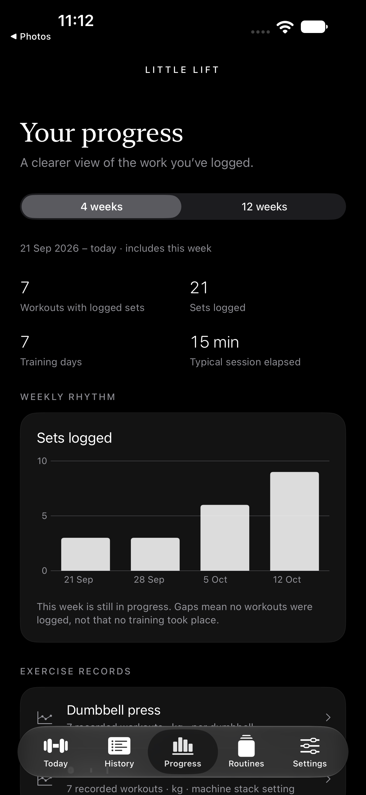
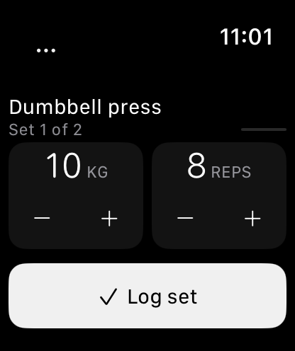

# Little Lift

**Your workout on your wrist. Your training history on your phone.**

A native SwiftUI workout logger for iPhone and Apple Watch. Start a routine, record the weight and reps you actually do, take your rest, and keep moving. A quiet monochrome interface keeps the next action within reach.

No backend. No ads. No API keys. No paid inference or runtime dependencies.

<p>
  
  
</p>

*Actual simulator captures from Build 10 using generic demonstration data. Current verification is documented below.*

## At a glance

| On iPhone | On Apple Watch |
| --- | --- |
| Import text, screenshots or workout JSON | Start, log a set, extend or skip rest |
| Review and edit every plan before saving | Adjust actual load and reps with touch or Crown |
| Keep routines and a weekly schedule | Defer a busy exercise or choose an approved alternative |
| Explore History, Progress and factual reports | Undo, finish early and recover after relaunch |
| Share context with your existing coach chat | Keep logging offline; deliver completed workouts later |

## What’s new in Build 12

Every completed workout now has an automatic review inside Little Lift: prescribed targets, actual logged values, coach observations and exact matching earlier sets. It is calculated from your saved records, works offline and needs no account or Shortcut setup. Missing evidence stays explicit; logging intervals are never called actual rest. Open it from Today, History or Workout reviews.

Search exercises from your own plan and routines alongside the local guide. Optional ChatGPT attempts expire safely if no result returns; the local review remains available. A rapid second Log touch no longer dismisses the newly opened Watch summary, and a review stays on the selected workout when another arrives.

Rhythm pulses can remain eligible while an actual HealthKit workout is running, including when the scene is inactive. Pause, interruption, completion, changed sets and disabled haptics stop them. Physical wrist-down behavior and haptic feel still require observation. This is a metronome, not a repetition detector.

Build 12 was installed and launched on the real iPhone and paired Watch with the existing free signing. Post-launch readback preserved the original state, active Watch session and motion files; no restore was needed.

See the [Build 12 checklist](docs/in-app-12-checklist.md) and [all 27 requirements](docs/feedback-27.md). The local factual review does not represent a ChatGPT response or an automatic connection to your existing conversation.

## What’s new in Build 11

Workouts can mix strength, walking, running and mobility. Cardio has its own Start/Pause/Resume/Done flow, optional machine readings and explicit timing; it never asks for invented repetitions or load. The editable importer accepts schema 2 and continues to read existing JSON. Try the [generic mixed workout](Examples/mixed-workout.json), marked as practice.

On Watch, defer partly completed exercises, choose the next one, confirm an approved substitute, or use a separate machine-change timer. The original prescription and actual results remain distinct. A real HealthKit workout session supports the official workout runtime; manual logging still works when permission or runtime fails. Wrist-raise return still needs physical verification.

Spanish and English, sober native system typography, compact progress and fixed primary actions keep the interface readable. iPhone adds editable coach context, a small exercise-help catalog, a local [getting-started guide](docs/onboarding/index.html), optional weekly goals and planned pauses. Optional rhythm pulses are a metronome, **not** repetition detection. Water reminders and factual feedback can be disabled.

Build 10’s local Progress dashboard, authenticated Shortcut actions and bounded input validation remain. Versioned storage refuses unknown future formats and preserves a protected pre-upgrade checkpoint. See [security and privacy](SECURITY.md); no software can promise to be unhackable.

Every requirement has its own status and evidence in [F01–F27](docs/feedback-27.md). Live ChatGPT, exact-thread delivery, physical haptics and repetition accuracy are not claimed verified. No app, site or personal data was published.

Build 11 was installed and launched on the real iPhone and paired Watch with free Personal Team signing on 17 October. Post-launch comparison confirmed data preservation after a Watch backup restoration; see the [delivery evidence and remaining limits](docs/verification.md).

## A normal workout

1. On iPhone, import a workout or choose a saved routine. Check its editable preview, then save and send it to Watch.
2. On Watch, tap **Start workout**. For strength, adjust actual weight/reps and **Log set**. For cardio, **Start activity**, pause when stopped, then **Done**. Rest controls stay visible; the branch button changes exercise and **…** holds details, undo and early finish.
3. Tap **Done** after finishing. The phone saves the completed workout before acknowledging it. History, Progress and coach reports then use the actual logged values.

No workout is silently shortened or replaced. Optional-work changes and approved substitutions preserve the original prescription. Coach proposals require acceptance.

## Run the project

Open `LittleLift.xcodeproj` in Xcode. The current source is verified with **Xcode 27**; deployment targets are iOS 18 and watchOS 11. Newer OS features are availability-gated. The optional Foundation Models path needs a compatible Apple Intelligence device; ordinary parsing, local Vision OCR and manual editing remain available without it.

For an existing paired simulator setup, double-click **Run Little Lift.command**, or run:

```sh
python3 scripts/run_simulators.py
```

The launcher preserves pairing and app data. Its explicit demo option populates only an empty phone install with a generic example.

For real devices, use Xcode’s free Personal Team signing. Keep private bundle/team overrides in `Config/Local.xcconfig`, based on the example file. Existing installations must keep their original identifiers and signing configuration. Refresh expiring personal profiles by updating in place; **do not uninstall**, because uninstalling removes local data. No paid developer enrollment or app publication is required. The owner’s private refresh script is deliberately excluded from this repository.

## Coach workflows

- **Existing conversation:** share a workout report or compact context export into your chosen chat, then import its proposed workout for review. This preserves continuity through explicit sharing.
- **Optional Shortcut:** Prepare Workout Review → Apple’s Use Model with ChatGPT → Save Workout Review. App Intents are implemented, authenticated and bounded; reviews are tied to attempts so cancelled or stale results cannot replace a proposal. The native simulator ran Prepare, then Use Model reported “This action is not currently available.” Live model execution and unattended automation remain unverified on the physical account. A Shortcut does **not** inherit or target an old ChatGPT conversation.
- **Observations:** coaches may request actual-versus-target sets, trustworthy logging intervals and one optional final-set effort rating. A Log interval includes exercise time; a countdown is prescribed rest. Neither proves actual rest duration.

[Generic import examples](Examples) · [Observation schema](docs/observations.md) · [Upgrade guide](docs/upgrade-guide.md)

## Verify changes

Portable core tests and the repository-boundary check also run in GitHub Actions. Native SDK 27 builds run locally on the Mac.

```sh
swift test
bash scripts/verify-mac.sh
python3 scripts/check_repository.py
```

Build 12 passes **121 engine tests** across sixteen suites, plus **10 launcher tests**. The Mac check also validates project generation, resources and icons, and builds both native simulator apps. See [observed verification](docs/verification.md) for simulator/device evidence and remaining limits.

After adding or removing native Swift files:

```sh
python3 scripts/generate_project.py
```

## Project map

```text
Apps/iPhone/          Import, routines, History, Progress, coach review
Apps/Watch/           Fixed workout controls, rest, recovery, optional motion
Apps/WatchLauncher/   Watch-face launcher
Apps/Shared/          Visual components and paired-device transport
Sources/WorkoutCore/  Foundation-only engine, validation, storage, analytics
Tests/                Portable engine regression tests
Config/               Public defaults and ignored local signing overrides
Examples/             Generic workout and historical-record fixtures
scripts/              Build checks, simulator launcher and project generation
docs/                 Design decisions, verification and feature status
```

## Privacy and experimental features

Workout files remain in app-local protected storage; normal device backup settings may include them. Data leaves Little Lift when you explicitly share it or run an external Shortcut. Motion recordings are excluded from backup. There is no telemetry service behind the Progress screen.

Motion replay is **opt-in and experimental**, limited to short captures for a few exercises. Suggestions require confirmation. Wrist-down reliability, battery use and repetition accuracy remain unvalidated; motion cannot measure external weight or certify safe technique. Physical haptics, hardware double tap, locked notifications and live ChatGPT are not claimed as verified by simulator testing.

[Feature checklist](docs/upgrade-checklist.md) · [Motion feasibility](docs/motion-feasibility.md) · [Engineering invariants](docs/engineering.md)

## Credits

Native system fonts and SF Symbols are provided by Apple; the monochrome app icon is preserved in `Design/Brand`. The vendored SwiftUI expert guidance retains its upstream MIT license. Project source uses the [MIT license](LICENSE).
